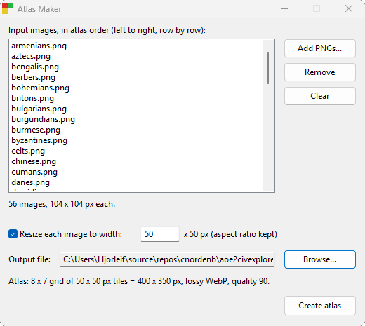

# Atlas Maker



A Windows app that packs PNG images of one resolution into a single atlas, saved as lossy WebP at quality 90.

## Using it

1. **Add PNGs...** (repeat to add more). The list shows the atlas order: alphabetical by file name, ignoring case,
   placed left to right and row by row. **Remove** and **Clear** edit the list.
2. All images must share one resolution; otherwise the app names the file that differs.
3. Optionally tick **Resize each image to width** and enter a width. The height follows the original aspect ratio,
   so four 100 x 100 images resized to 60 make a 120 x 120 atlas.
4. **Browse...** for the output file, then **Create atlas**.

The grid is the one whose atlas is closest to square (four 100 x 100 images make 200 x 200). Ties go to fewer
empty cells, then to the wider grid. Empty cells are transparent. WebP limits an atlas to 16383 x 16383 px.

## Building

Needs CMake 3.20+, MinGW-w64 GCC, and git. The first configure downloads libwebp v1.6.0.

```sh
cmake -S . -B build -G Ninja -DCMAKE_BUILD_TYPE=Release
cmake --build build
ctest --test-dir build
```

The result, `build/atlas_maker.exe`, is a single file that needs only what ships with Windows 10 and 11.

## Layout

- `src/core`: grid layout, PNG decoding and resizing (Windows Imaging Component), WebP encoding, atlas assembly.
- `src/gui`: the Win32 window.
- `res`: the application manifest (themed controls, DPI awareness).
- `tests`: layout unit tests and atlas tests against the fixtures in `tests/data`.

## Acknowledgement

The development of Atlas Maker was accelerated with Claude Opus 5.5