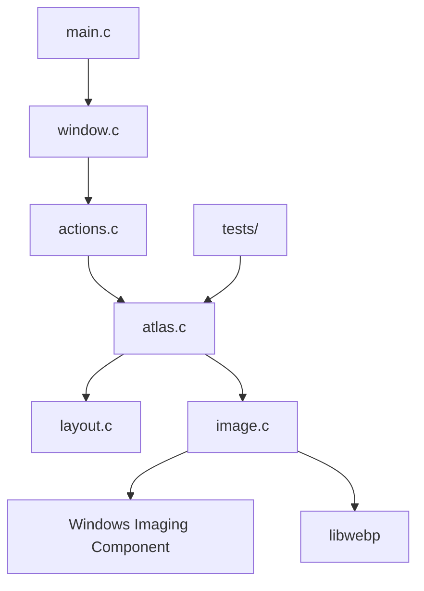

# Atlas Maker: maintainer's guide

1. [Updating libwebp](#updating-libwebp)
2. [How the code works](#how-the-code-works)
   - [Files and folders](#files-and-folders)
   - [Diagram](#diagram)
   - [Building and running](#building-and-running)
   - [How an atlas is made](#how-an-atlas-is-made)
   - [The window](#the-window)
   - [Tests](#tests)
   - [Rules for changing the code](#rules-for-changing-the-code)

## Updating libwebp

libwebp is the one library Atlas Maker does not get from Windows. It writes the WebP file. When a new version of it
is out, at https://github.com/webmproject/libwebp/tags, take it in like this. You need the programs listed under
[Building and running](#building-and-running), a connection to the internet, and about ten minutes.

1. **Change the version.** In `CMakeLists.txt`, find the line `GIT_TAG v1.6.0` and write the new tag, such as
   `GIT_TAG v1.7.0`.
2. **Delete the old build.** Delete the folder `build`. It holds the old version of libwebp.
3. **Build and test.** In Git Bash, in the project's folder:

   ```sh
   cmake -S . -B build -G Ninja -DCMAKE_BUILD_TYPE=Release && cmake --build build && ctest --test-dir build --output-on-failure
   ```

   The first command downloads the new libwebp. At the end you should see `100% tests passed`.
   - If you see `Test 15 failed`, or another number, look the test up in [TESTS.md](TESTS.md) to see what no longer
     holds, and put the old tag back if you cannot mend it.
   - If the build stops at an option that starts with `WEBP_BUILD_`, libwebp has renamed or removed one of the tools
     that `CMakeLists.txt` turns off. Take its name out of the `foreach` line near the top.
4. **Try the app.** Start `build/atlas_maker.exe`, add a few PNG images of one resolution, choose an output file,
   and press **Create atlas**. Open the WebP file and look at it.
5. **Write the new version down.** Change `1.6.0` in `AGENTS.md`, and record the change in the development log, as
   [Rules for changing the code](#rules-for-changing-the-code) says.

## How the code works

Atlas Maker has two halves. `src/core` knows how to make an atlas and knows nothing about windows. `src/gui` is the
window: it collects what the user wants and hands it to `src/core`. The tests use only `src/core`.

### Files and folders

| File or folder | What it holds |
| --- | --- |
| `src/core/` | Making an atlas: `layout` chooses the grid, `image` reads, resizes and writes pictures, `atlas` puts them together. |
| `src/gui/` | The window: `main.c` starts the app, `window.c` builds the window, `actions.c` does what each button does, `app.h` is shared by the three. |
| `res/` | What is built into the `.exe` besides code: `app.rc` lists it, `app.manifest` asks Windows for themed controls and sharp text, `resource.h` numbers the icon. |
| `tests/` | The tests, and in `tests/data/` the fixtures they use. See [Tests](#tests). |
| `CMakeLists.txt` | Tells CMake how to build the app and the tests, and which libwebp to download. |
| `favicon.ico` | The app's icon. |
| `image.png` | The screenshot shown in `README.md`. |
| `documentation/` | This guide, `RULES.md`, `REQUIREMENTS.md`, `TESTS.md`, `DECISIONS.md`, `TERMINOLOGY.md`, and the development log in `DEVLOG/`. |
| `README.md` | Introduces the project. |
| `LICENSE` | The terms under which anyone may use the project. |
| `AGENTS.md` | What an AI agent must know before it changes anything here: what to read first, what it must never do, and when a change is done. |
| `CLAUDE.md` | The same for Claude Code, which reads this file by itself. It loads `AGENTS.md` and `RULES.md`. |
| `.claude/skills/` | Step-by-step procedures for AI agents, one folder each, such as how to write the development log. `ub-mode` is copied from another project and keeps its licence beside it. |
| `.claude/settings.json` | Stops Claude Code from committing and from changing `REQUIREMENTS.md`. |
| `.github/` | What GitHub shows contributors: how to contribute, report a bug or a security hole, the pull request form, and the accessibility checklist. |
| `.github/workflows/checks.yml` | Tells GitHub to run the checks and the tests on every push and pull request, on Windows. |
| `.github/scripts/check-rules.sh` | Checks the rules a script can check; see [Tests](#tests). |
| `.gitattributes`, `.gitignore` | How Git treats line endings, and which files it leaves out. |

### Diagram



`actions.c` and the tests also call `layout.c` directly, to learn the grid before any picture is read.

### Building and running

You need Windows 10 or 11 with [CMake](https://cmake.org) 3.20 or newer, [Ninja](https://ninja-build.org), MinGW-w64
GCC and Git, all found from the command line. In Git Bash, in the project's folder:

```sh
cmake -S . -B build -G Ninja -DCMAKE_BUILD_TYPE=Release
cmake --build build
```

The first command downloads libwebp 1.6.0, so it needs the internet once. Only the library is built, not libwebp's
own command-line tools. The result is `build/atlas_maker.exe`, a single file that needs only what ships with Windows
10 and 11; start it by double-clicking it.

The icon and `app.manifest` are built into the `.exe` through `res/app.rc`. `CMakeLists.txt` names both as things
`app.rc` depends on, because the resource compiler does not report them itself; without that, changing the icon would
not rebuild anything.

### How an atlas is made

`atlas_build` in `atlas.c` takes an `AtlasRequest`: the paths of the images in any order, the tile size, and the
output file. It works in four steps, and returns 0, or -1 with a message for the user.

1. **Sort.** `atlas_sort` puts the paths in atlas order. It compares file names without regard to case and without
   the language of the machine, so the order is the same everywhere. Two files of the same name in different folders
   are ordered by their whole paths.
2. **Inspect.** `atlas_inspect` reads only the resolution of each image, and stops with a message that names the file
   if one cannot be read or differs from the first.
3. **Lay out.** `layout_compute` in `layout.c` tries every number of columns and keeps the best grid: the one closest
   to square, then the one with fewer cells, then the one with more columns. "Closest to square" compares the longer
   side divided by the shorter. The two divisions are compared by multiplying crosswise, in whole numbers, so that
   two equal shapes are found exactly equal. Example: two images of 200 x 100 px make 1 column and 2 rows, 200 x 200.
4. **Draw and save.** A canvas of the atlas's size is filled with zeros, which is why a cell without an image is
   transparent. Each image is read at the tile size by `image_load`, copied into its cell, and the canvas is written
   by `image_save_webp` at `ATLAS_WEBP_QUALITY`, 90.

Things in `layout.c` worth knowing:

- `LAYOUT_MAX_DIM`, 16383, is the widest and tallest picture WebP can hold.
- `layout_scaled_height` gives the height for a new width, rounded to the nearest pixel and at least 1. A height over
  the limit comes back as `LAYOUT_MAX_DIM + 1`, which `layout_compute` then refuses.
- A `Layout` holds `cols`, `rows`, the tile size, and `width` and `height`, which are `cols` and `rows` times the
  tile size.

Things in `image.c` worth knowing:

- It uses Windows Imaging Component, which needs COM. Call `CoInitializeEx` and then `image_startup` once, before
  any other `image_` function, and `image_shutdown` at the end. `main.c` and the tests do this.
- An `Image` holds its pixels as red, green, blue, alpha, 4 bytes each, rows from the top, alpha not premultiplied.
  Free it with `image_free`.
- `IMAGE_ERR_READ` means the file is missing, unreadable or not an image, or memory ran out.
- When an image must be resized, it is first converted to premultiplied alpha and then scaled. Otherwise the colours
  hidden under transparent pixels would bleed into the edges.
- `INTERPOLATION_HIGH_QUALITY_CUBIC` is written as the number 4 because MinGW's `wincodec.h` lacks the name
  `WICBitmapInterpolationModeHighQualityCubic`, which Windows 10 and later have.
- `advance` swaps one step of the picture pipeline for the next: when the step worked it releases the old one, and
  when it failed it leaves the old one alone.
- If writing the file fails halfway, the file is deleted, so no cut-off file is left behind.

### The window

`window.c` holds a table, `controls`, with one line for each label, button and box: its text, its place and size, and
where to keep its handle if the code needs it later. Places and sizes are written for a screen at 96 DPI and
multiplied up by `scale` for the screen in use. To move or add a control, change the table.

All that the window remembers is in one `App`, named `app`, declared in `app.h`: the handles, and the input list as
`paths` and `count`, which the app owns and keeps in atlas order. `src_w` and `src_h` are the resolution the images
share, or 0 while they cannot be used.

`actions.c` has one function for each thing the user does: `on_add`, `on_remove`, `on_clear`, `on_browse` and
`on_create`. After any of them, one of two functions brings the window up to date:

- `inputs_changed` when the input list changed: it sorts the list, shows it, and inspects the images.
- `settings_changed` when the width or the output file changed: it works out the tile size and the grid, shows the
  summary line, and switches **Create atlas** on only when an atlas can be made and an output file is chosen.

Things worth knowing:

- The dialog for adding files gives back either one whole path, or a folder followed by file names, each ended by a
  zero character. `add_selection` reads both forms. The buffer for it, `OPEN_BUFFER_LEN`, has room for a few thousand
  file names; with more, the app asks the user to add them in smaller batches.
- `add_path` takes over the path it is given and frees it if it is not kept. `join_path` adds a backslash between
  folder and name only when the folder does not already end in one, as `C:\` does.
- The width box takes 5 digits at most, as many as `LAYOUT_MAX_DIM` has.
- The loop in `window_run` passes each message through `IsDialogMessageW`, which is what makes the Tab key move
  between the controls.
- Windows makes the small icon of the title bar from the one icon in `app.rc`.

### Tests

Run the tests with:

```sh
cmake -S . -B build -G Ninja -DCMAKE_BUILD_TYPE=Release && cmake --build build && ctest --test-dir build --output-on-failure
```

GitHub runs them on every push and pull request; a green tick in the repository's **Actions** tab means they all
passed.

The tests are one program, `run_tests`. Each test is a small function that makes one check and returns whether it
held. `tests/test_layout.c` holds the tests of the grid, `tests/test_atlas.c` the tests that build an atlas from
the fixtures and read the WebP file back, and `tests/test_rules.c` the tests that read the code itself. Each file
lists its tests in a table at its end, in the order they run. `tests/run_tests.c` runs the three tables and numbers
the tests as they run, so a failure reads `Test 15 failed`, and [TESTS.md](TESTS.md) says what Test 15 checks.
`tests/check.h` is shared by the four. CTest gives `run_tests` the project's folder, where it finds the fixtures and
the code.

The tests in `test_rules.c` keep two rules that `check-rules.sh` cannot check. Test 25 fails when a code file under
`src`, `res` or `tests` has a comment, or `CMakeLists.txt` a line that starts with `#`; it does not mind `//` inside
quotes, as in a web address. Test 26 fails when a function is over 60 lines. It knows a function by its `{` and `}`
standing alone at the start of a line, as all the code here is written. Both name the file and the line. A new
folder of code must be added to `code_folders` at the top of `test_rules.c`.

The fixtures in `tests/data/` are 100 x 100 px, each of one colour: `apple.png` red, `Banana.png` green, `cherry.png`
blue and `date.png` yellow. `odd_50x50.png` is 50 x 50 px, for the tests of images that differ. Lossy WebP shifts
colours a little, so a colour passes when each channel is within 24 of the fixture's, `COLOR_SLACK`.

When you add, change or remove a test, add or remove it in the table at the end of its file, and update `TESTS.md`:
the numbers follow the order of the tables: `layout_tests`, `atlas_tests`, then `rules_tests`.

GitHub also runs `.github/scripts/check-rules.sh`, which checks what a script can check without knowing the language of
the code: that no folder holds too many files, that no two files share a name, that no line or file of code is too long,
that the development log keeps its form, and that `TESTS.md` numbers its tests 1, 2, 3 and so on. Run it yourself before
you commit, from the project's folder:

```
bash .github/scripts/check-rules.sh
```

On Windows, run it in Git Bash. Each line says `ok`, `skip`, `todo` or `FAIL`, and every `FAIL` names the file and the
rule. A `todo` does not fail: it lists the placeholders, names in double braces, still to fill in from the template.

Most of accessibility cannot be tested. `.github/ACCESSIBILITY.md` lists every success criterion of WCAG 2.2 AA; those
marked **human verification required** you check yourself, by using the interface as the item says, whenever a change
touches what the item is about. Mark each `[x]` when it holds.

AI agents write code by `ub-mode`, which runs three tools that are not part of the project: crapper, which scores
each function by how complex it is and how much of it the tests run; dryer, which finds code written twice; and
mutator, which changes the code on purpose to see whether a test notices. They need Python 3.11 or newer; for C also
gcc, CMake and gcovr (`pip install gcovr`), and on Windows Ninja. To have them, clone them once next to the project's
folder, in Git Bash:

```
cd ..
git clone https://github.com/cnordenb/crapper
git clone https://github.com/cnordenb/dryer
git clone https://github.com/cnordenb/mutator
```

The first run of each sets itself up. What they write in the project, `.metrics/` and `target/`, Git leaves out.
`AGENTS.md` lists the languages they work for.

### Rules for changing the code

`RULES.md` has the full list; the tests and `check-rules.sh` check most of it.

- No file over 400 lines of code, no function over 60, and no line over 120 characters.
- No folder over 7 files, except `documentation/DEVLOG/`; the main folder may hold 9.
- No two files with the same name, except `SKILL.md`.
- No comments in the code. Explain what needs explaining in this guide instead.
- `REQUIREMENTS.md` defines what the project does, and only the chief developer may change it.
- Record what you change, and why, in the last part of `documentation/DEVLOG/`, under the day's date, and list any
  decision in `DECISIONS.md`.
- Only humans commit. AI agents leave their work for a human to read, test and commit.
